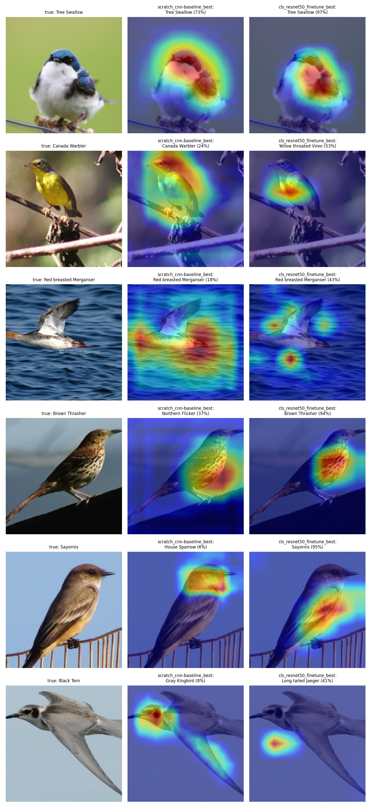

# Plumage

CSE 485 / 488 project on the **CUB-200-2011** bird dataset (200 species, ~11.8k images, 10 captions per image).
Milestone 1: data analysis (EDA) and bird species classification, with a CNN trained from scratch, a fine-tuned ResNet-50, hyperparameter tuning and Grad-CAM.
The team plan is in [MILESTONE1_PLAN.md](MILESTONE1_PLAN.md).


*Grad-CAM on test images. Left: input. Middle: the scratch CNN. Right: the fine-tuned ResNet-50, which looks at the bird instead of the background.*

## Results (test set, 5,794 images)

| Model | Config | Test accuracy | Macro F1 |
|---|---|---|---|
| CNN from scratch | `configs/cls_scratch.yaml` | 40.2% | 38.8% |
| ResNet-50, frozen backbone | `configs/cls_resnet50_frozen.yaml` | 64.3% | 64.0% |
| **ResNet-50, fine-tuned (final)** | `configs/cls_resnet50_finetune.yaml` | **82.9%** | **82.9%** |
| ResNet-50, tuned lr / weight decay | `configs/cls_resnet50_tuned.yaml` | 81.8% | 81.8% |

The comparison with published results is in [docs/benchmark.md](docs/benchmark.md), and the full notes are in [docs/report_notes.md](docs/report_notes.md).

## Setup

```bash
git clone <repo-url> plumage
cd plumage
pip install -r requirements.txt
```

On your own machine you can make a virtual environment first (`python -m venv .venv`, then activate it).
On Colab/Kaggle just run the `pip install`.

The dataset (~1.2 GB) downloads automatically into `data/hf_cache/` the first time you run a command.

### Trained models

Checkpoints are on the team Google Drive.

Put them in `outputs/checkpoints/`:
- `cls_resnet50_finetune_best.pt`: the final ResNet-50
- `scratch_cnn-baseline_best.pt`: the CNN from scratch

## How to run

```bash
# Data analysis: figures go to outputs/figures/eda/
python -m src.cli eda --config configs/base.yaml

# Train: checkpoint goes to outputs/checkpoints/<config name>_best.pt, curves to outputs/figures/curves/
python -m src.cli train --task classification --config configs/cls_scratch.yaml
python -m src.cli train --task classification --config configs/cls_resnet50_finetune.yaml

# Hyperparameter search (4 short trials each): results go to outputs/tuning/<method>.json
python -m src.cli tune --task classification --method grid   --config configs/cls_resnet50_finetune.yaml
python -m src.cli tune --task classification --method random --config configs/cls_resnet50_finetune.yaml

# Predict one image: prints the top-5 species; --gradcam saves a heatmap to outputs/predictions/
python -m src.cli predict --task classification --image path/to/bird.jpg --checkpoint outputs/checkpoints/cls_resnet50_finetune_best.pt --gradcam

# Error analysis on the test set: the 5 most confused species pairs plus Grad-CAM on correct
# and wrong predictions. --compare adds a second model on the same images. Output: outputs/analysis/
python -m src.cli analyze --task classification --checkpoint outputs/checkpoints/scratch_cnn-baseline_best.pt --compare outputs/checkpoints/cls_resnet50_finetune_best.pt

# Quick tests (no internet or dataset needed)
python -m pytest
```

`predict` only needs the checkpoint and the image, not the dataset. Training on a CPU is slow (about 16 min per epoch), so we trained on a Kaggle/Colab T4 GPU.

All runs are saved with MLflow. To see them:

```bash
mlflow ui --backend-store-uri sqlite:///mlflow.db
```

### On Colab

```bash
!git clone <repo-url> plumage
%cd plumage
!pip install -q -r requirements.txt
!python -m pytest -q
!python -m src.cli eda --config configs/base.yaml
```

Choose a GPU runtime (Runtime → Change runtime type → T4) before training.

## Data split

| Split | Images | Used for |
|-------|--------|----------|
| train | 5,389 | training |
| val   | 600 (3 per class, taken from the train set) | choosing models and hyperparameters |
| test  | 5,794 | final evaluation only |

The val images are saved in `configs/splits/val_indices.json` so everyone uses the same ones.
5 duplicate images found by the EDA are removed from train (`data.exclude_train_files` in `configs/base.yaml`).

## Folders

```
configs/      settings for each run (YAML), the val split and the 200 species names
notebooks/    experiments only
docs/         report notes, benchmark, references, figures
src/
  cli.py          all commands start here
  data/           dataset, split, transforms, caption cleaning
  models/         CNN encoders (scratch, ResNet-50) and classifier
  training/       training loop and hyperparameter search
  evaluation/     metrics and confused species pairs
  visualization/  EDA plots, training curves, Grad-CAM
  utils/          config, seed, MLflow
tests/        quick tests
outputs/      figures, checkpoints, analysis (not on GitHub)
```
