# Plumage: Milestone 1 Report
**CSE 485 / 488 Deep Learning, From Pixels to Language**
**Milestone 1:** EDA, classification and encoder training
**Team:** Jana, Habiba, Nouran, Mohamed, Abdallah

---

## 1. Introduction

The project builds one visual encoder and uses it for three tasks: species classification (Milestone 1), colorization and captioning (Milestone 2). This report covers Milestone 1: understanding the data, training a CNN from scratch as a baseline, transfer learning with a pretrained ResNet-50, hyperparameter tuning, explaining the models with Grad-CAM, and comparing with published results.

**Dataset.** We use the default dataset, CUB-200-2011 with the captions of Reed et al. (2016), loaded from Hugging Face (`Multimodal-Fatima/CUB_train` and `CUB_test`). It has 11,788 photos of 200 North American bird species and 10 captions per photo. It fits all three tasks: every image has a species label (classification), the photos are good enough to build grayscale/color pairs (colorization), and it ships with captions (captioning). At about 1.2 GB it also trains on a free T4 GPU.

**Why it is hard.** It is *fine-grained*: many species differ only in small details (wing bars, eye rings, bill shape), and there are only about 30 photos per species.

---

## 2. Data

All figures come from `python -m src.cli eda --config configs/base.yaml`.

### 2.1 Splits
The dataset only has train (5,994) and test (5,794). We hold out **3 images per class (600) from train as validation**, with a fixed seed saved in `configs/splits/val_indices.json`, so that hyperparameters and model choices are never made on test. The split is per class: with ~30 images per class, a plain random 10% could give some species 0 validation images.

| Split | Images | Used for |
|---|---|---|
| train | 5,389 (5,994 − 600 val − 5 duplicates) | training |
| val | 600 | model selection and tuning |
| test | 5,794 | final evaluation, used once per model |

### 2.2 EDA findings and the decisions they led to

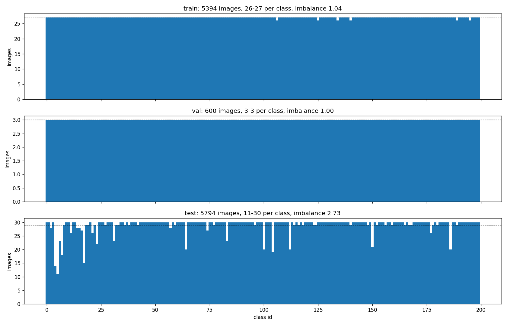
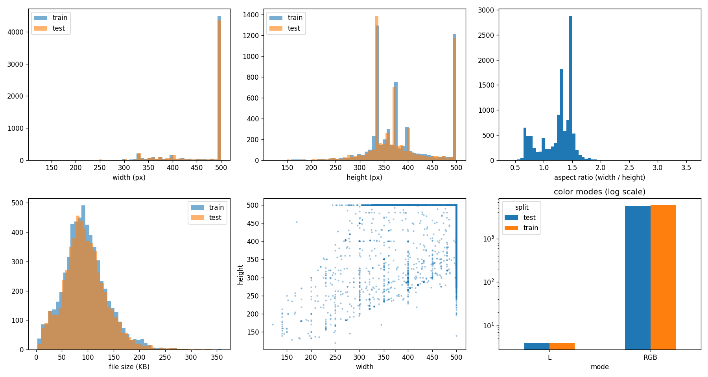

| Finding | Decision | Why |
|---|---|---|
| **Classes:** train has 26–27 images per class (imbalance 1.04), test has 11–30 (imbalance 2.73). | No class weights. We report **macro F1** next to accuracy. | Train is balanced. Test is not, and macro F1 counts every species equally. |
| **Image sizes:** the longest side is almost always 500 px (median 500×375). Aspect ratio ranges from 0.38 to 3.6. 148 images have a side under 224 px. | Train: `RandomResizedCrop(224, scale=(0.5, 1))`. Eval: `Resize(256)` + `CenterCrop(224)`. | Images are larger than 224. Keeping at least 50% of the image avoids cropping out small birds. |
| **Color modes:** 8 grayscale images, no corrupted files. | Convert everything to RGB. | The images are valid; the model needs 3 channels. |
| **Duplicates:** pHash found 8 candidate pairs, but 3 were false matches (different birds on plain sky or snow). A second check with dHash confirmed 3 train–train and **2 train–test** duplicates. | Removed 5 train images (`data.exclude_train_files`). | Train–test duplicates leak test images into training and inflate test accuracy. |
| **Channel statistics:** CUB mean (0.486, 0.501, 0.433) vs ImageNet (0.485, 0.456, 0.406). | Pretrained models use ImageNet stats; the scratch CNN uses CUB stats. | A pretrained model expects the statistics it was trained with. CUB is greener and bluer (trees, sky, water). |

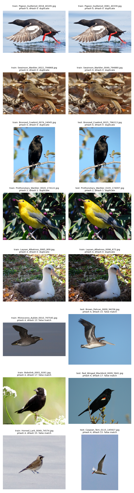
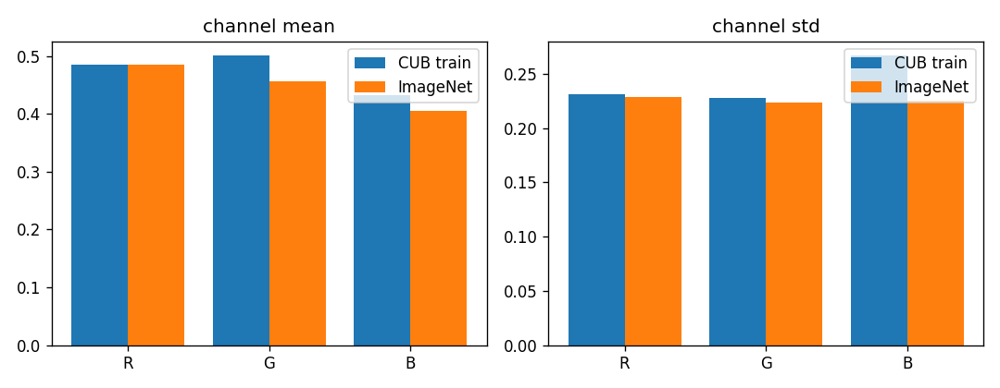

### 2.3 Captions (prepared now for Milestone 2)

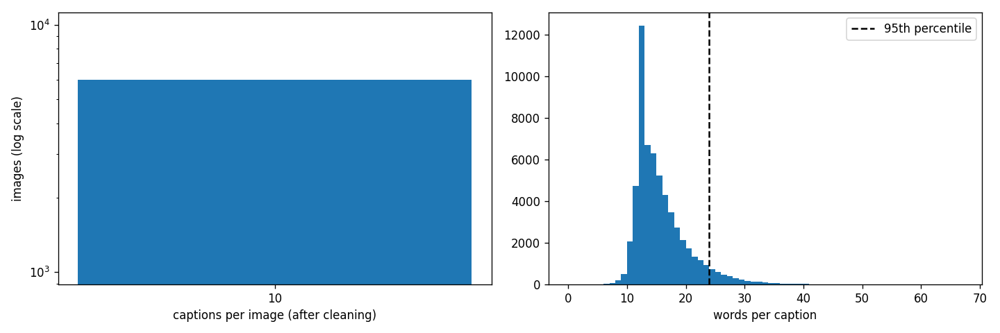
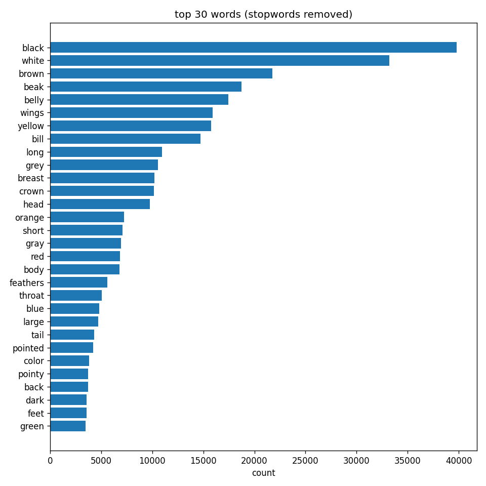

- Every image has exactly 10 captions, with a mean length of 15.3 words (median 14, 95% under 24). We will cut captions at about 25–30 tokens.
- About 100 captions have a broken character (`�`) instead of every space, plus odd symbols (`/` 266 times, `;` 247, `&` 196). `clean_caption()` in `src/data/text.py` lowercases, replaces `�` and `/` with a space, replaces `&` with "and", removes other symbols and normalizes spacing.
- The vocabulary goes from 6,690 words before cleaning to 4,076 after. Only 1,243 words appear 5 or more times; the rest are mostly typos (`abdomin`, `ablack`). For Milestone 2 we will keep words with frequency ≥ 5 and map the rest to `<unk>`.

### 2.4 Augmentation

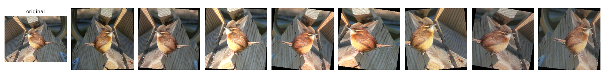

Random resized crop, horizontal flip, rotation up to ±10°, and mild color jitter (brightness, contrast and saturation 0.2, **hue only 0.02**). There are **no vertical flips**, because birds are not upside down. We keep hue almost fixed because color separates many species (Summer vs Scarlet Tanager).

---

## 3. Models

All encoders have the same interface: `forward_features()` (spatial map), `forward()` (pooled vector), `out_dim` and `get_gradcam_layer()`. `Classifier` is encoder → dropout → linear layer (200 classes). `build_model(cfg)` picks the encoder from the config, so changing the encoder is one line of YAML, and the trainer, metrics, Grad-CAM and CLI don't change. Milestone 2 reuses `forward_features()` for colorization and captioning.

**Scratch CNN** (`ScratchCNN`, 4.82M parameters):

| Block | Layers | Channels | Output (224 input) |
|---|---|---|---|
| 1–5 | (Conv3×3-BN-ReLU) ×2, MaxPool 2×2 | 3→32→64→128→256→512 | 112 → 56 → 28 → 14 → 7 |
| Head | Global average pool, dropout 0.3, Linear | 512 → 200 | 1×1 |

Global average pooling instead of flattening makes the last layer 512→200 instead of 25,088→200, which means far fewer parameters and less overfitting.

**ResNet-50** (`ResNet50Encoder`, 23.9M parameters): torchvision ResNet-50 with ImageNet weights `IMAGENET1K_V2`, with its average pool and 1000-class layer removed. It gives a 2048×7×7 map. We use it in two ways:
- **Frozen:** the encoder weights are locked (`freeze_backbone: true`) and kept in eval mode, so BatchNorm statistics don't drift either. Only the last layer learns (0.41M parameters).
- **Fine-tuned:** every layer learns, with a small learning rate (1e-4) so the ImageNet knowledge is adjusted, not destroyed.

---

## 4. Experiments

All models are trained with `train_model()` (`src/training/trainer.py`): AdamW, a cosine learning-rate schedule, cross-entropy, mixed precision on GPU, batch size 32, and early stopping on **val accuracy**, saving the best epoch. Runs were on a Kaggle T4 GPU.

| Model | Config | lr | Epochs | Trainable params | Train acc | Best val acc | Test acc | Macro F1 | Time |
|---|---|---|---|---|---|---|---|---|---|
| Scratch CNN | `cls_scratch.yaml` | 3e-4 | 40 | 4.82M | 47.3% | 38.3% (ep. 39) | 40.2% | 38.8% | – |
| ResNet-50 frozen | `cls_resnet50_frozen.yaml` | 1e-3 | 15 | 0.41M | 81.9% | 61.0% (ep. 11) | 64.3% | 64.0% | 9.6 min |
| **ResNet-50 fine-tuned** | `cls_resnet50_finetune.yaml` | 1e-4 | 20 | 23.9M | 99.1% | **82.0%** (ep. 16) | **82.9%** | **82.9%** | 13.3 min |
| ResNet-50 tuned | `cls_resnet50_tuned.yaml` | 1.35e-4 | 16 (early stop) | 23.9M | 99.4% | 81.3% (ep. 11) | 81.8% | 81.8% | 10.7 min |

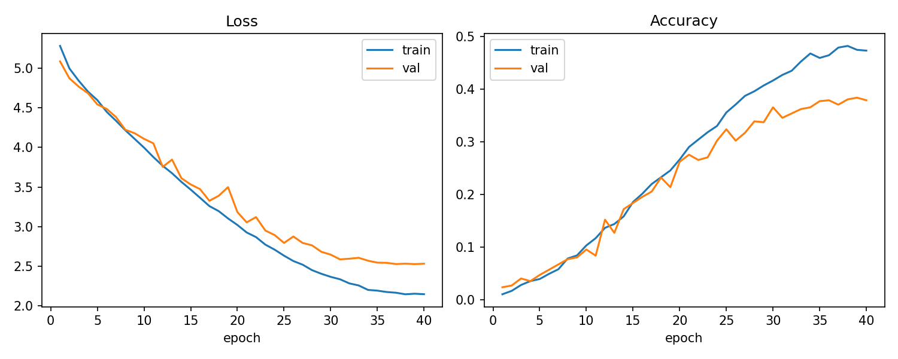
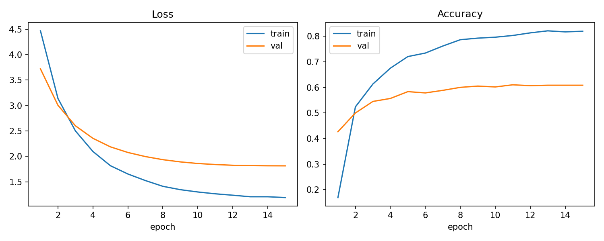
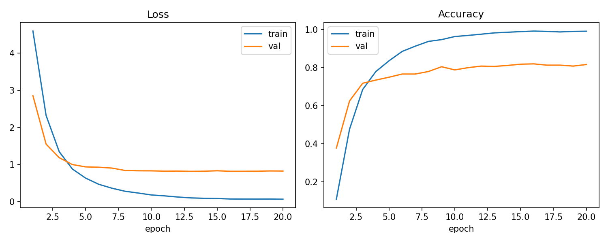

**From scratch vs transfer learning:**
- **Scratch CNN (40.2%).** 80× better than chance (0.5%), but with ~27 images per species and no prior knowledge it can't learn fine-grained features. Train accuracy is only 9 points above val, so it is under-fitting more than over-fitting. Val was still rising at epoch 40, but the cosine schedule had brought the learning rate to almost 0.
- **Frozen ResNet-50 (64.3%).** 24 points better while training only the last layer. ImageNet features already describe birds well. It plateaus at epoch 11, because one linear layer on fixed features has limited capacity.
- **Fine-tuned ResNet-50 (82.9%).** Another 18.6 points, more than double the scratch CNN, because every layer adapts to bird details. Train accuracy reaches 99% while val stays at 82%, so it memorizes the training images. But val loss does not rise, so generalization is not hurt.

---

## 5. Hyperparameter tuning

We tuned the learning rate and weight decay of the fine-tuned ResNet-50 (`python -m src.cli tune --method grid|random`). Each trial is 5 epochs, starts from the same seed, uses only train/val, and is its own MLflow run.

- **Grid search:** lr {1e-4, 3e-4} × weight decay {1e-4, 1e-3}, 4 trials.
- **Random search:** 4 trials, with lr and weight decay sampled **log-uniformly** between the same limits. Sampling the same 4 points would just be the grid in another order, and a log scale suits parameters that matter by their order of magnitude.

| Method | Best lr | Best weight decay | Best val acc (5 epochs) | Trials | Time |
|---|---|---|---|---|---|
| Grid | 3e-4 | 1e-4 | 79.5% | 4 | 12.5 min |
| Random | 1.35e-4 | 1.67e-4 | 79.7% | 4 | 12.6 min |

**Result: tuning did not beat the default.** The best random setting, trained for the full schedule, reached 81.3% val / 81.8% test, below the default's 82.0% / 82.9%. The reasons:
1. 5-epoch trials don't rank settings the same way as 20-epoch runs.
2. All trials with lr between 1.35e-4 and 3e-4 landed between 78.2% and 79.7%. On 600 val images 1 point is 6 images, so the differences are noise.
3. The default lr of 1e-4 was already in the good range.

Grid and random search reached the same score in the same time. With only 2 parameters and 4 trials, neither has an advantage. Random search would matter more with more parameters, where only a few of them really matter (Bergstra & Bengio, 2012).

---

## 6. Experiment tracking

Every run is logged with MLflow (`src/utils/tracking.py`, local `sqlite:///mlflow.db`): all config values as parameters, per-epoch train/val loss and accuracy and the learning rate, test metrics, the training-curve figure and the checkpoint. Tuning trials and `analyze` runs are logged too. View them with `mlflow ui --backend-store-uri sqlite:///mlflow.db`.

> **TODO before export:** add screenshots of (1) the run list with all classification runs, (2) the val accuracy chart comparing scratch / frozen / fine-tuned, and (3) the tuning trials table.

---

## 7. Evaluation

`evaluate()` in `src/evaluation/metrics.py` computes the metrics below on the test set:

| Metric | What it measures | Our final model |
|---|---|---|
| Accuracy | Share of test images whose top prediction is the right species | 82.9% |
| Top-5 accuracy | Share where the right species is among the 5 highest scores | Scratch: 72% |
| Macro precision | For each species: of the images predicted as it, how many really are it. Then averaged over species | – |
| Macro recall | For each species: of its images, how many were found. Then averaged over species | – |
| Macro F1 | Harmonic mean of precision and recall, per species, then averaged. Every species counts equally, which matters because test has 11–30 images per species | 82.9% |
| Confusion matrix | Rows = true species, columns = predicted. Used to find which species get mixed up | Section 8 |

Macro F1 equals accuracy for the final model, so it is not doing well only on the species with more test images. With 5,794 test images, the 95% confidence interval on accuracy is about ±1 point.

---

## 8. Explainability (Grad-CAM)

**Method** (`src/visualization/gradcam.py`, our own implementation):
1. A forward hook on the last conv layer saves its feature maps A (512×7×7 for the scratch CNN, 2048×7×7 for ResNet-50).
2. A hook on that tensor saves the gradients dA when the class score is backpropagated.
3. Each channel's weight is the mean of its gradient: weights = mean(dA). The map is CAM = ReLU(Σ weights · A).
4. CAM is resized to 224×224 and normalized to 0..1.

For the frozen ResNet-50 the input is set to require gradients. Otherwise no gradient reaches the frozen layer and the hook never fires.

**Error analysis: the 5 most confused species pairs** (`python -m src.cli analyze`; mistakes counted in both directions):

| # | Scratch CNN | ResNet-50 fine-tuned |
|---|---|---|
| 1 | Eared Grebe ↔ Horned Grebe: 13 | Long-tailed Jaeger ↔ Pomarine Jaeger: 15 |
| 2 | Arctic Tern ↔ Common Tern: 13 | Chuck-will's-widow ↔ Whip-poor-will: 14 |
| 3 | Loggerhead Shrike ↔ Great Grey Shrike: 12 | Brandt's Cormorant ↔ Pelagic Cormorant: 14 |
| 4 | Arctic Tern ↔ Forster's Tern: 12 | Acadian Flycatcher ↔ Yellow-bellied Flycatcher: 12 |
| 5 | Blue-winged Warbler ↔ Prothonotary Warbler: 12 | Arctic Tern ↔ Common Tern: 12 |

All of ResNet-50's top pairs are near-identical species of the same family. The scratch CNN also confuses species that only share a color (two yellow warblers).

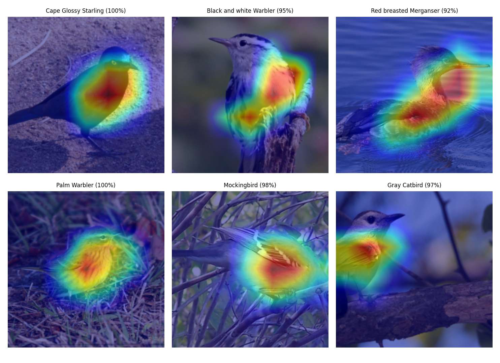
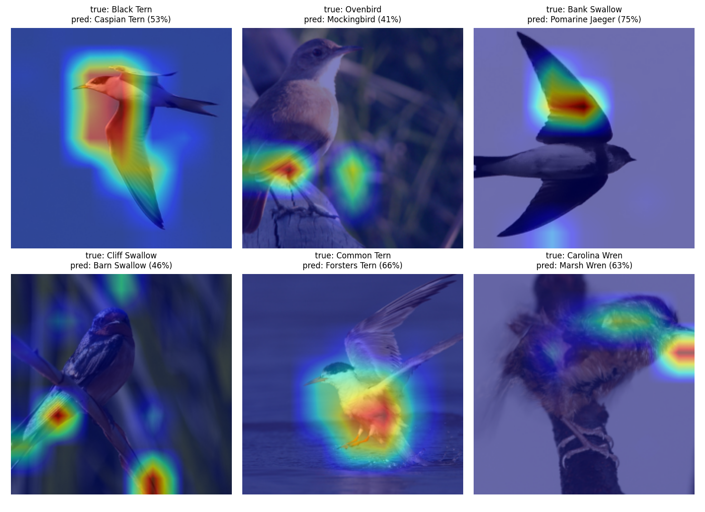
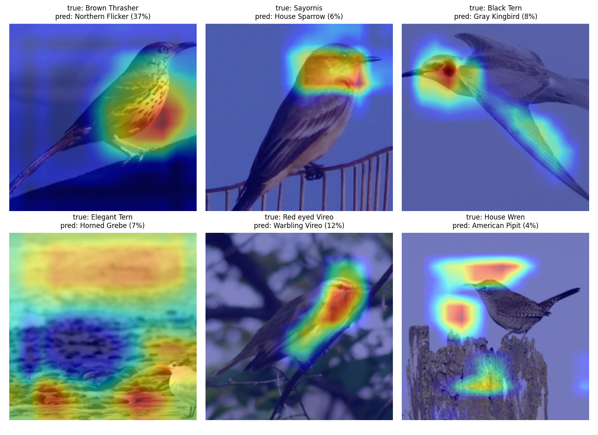
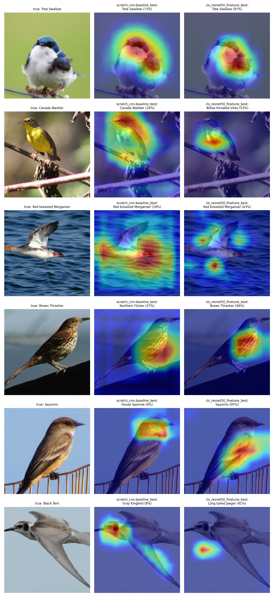

**Analysis:**
- **ResNet-50 correct (92–100% confidence):** the attention is on the body, breast and wing pattern, and the background stays cold.
- **ResNet-50 wrong (41–75% confidence):** the confidence is noticeably lower. Most mistakes are lookalikes (Common → Forster's Tern, Cliff → Barn Swallow). A few show misplaced attention: the legs and perch for an Ovenbird, the reeds for a Cliff Swallow. A Bank Swallow seen from below in flight is called a Pomarine Jaeger, because only its wing silhouette is visible.
- **Scratch CNN wrong (4–37% confidence):** the attention is often on the **background**. On an Elegant Tern it covers the water and predicts Horned Grebe, another water bird; on a House Wren it covers the sky. With little data and no pretraining it learned context shortcuts. Some mistakes are still reasonable (Brown Thrasher → Northern Flicker, both with spotted breasts).
- **Side by side:** where the scratch CNN fails (Brown Thrasher, Sayornis), ResNet-50 is right at about 95%, focused on the bird. Grad-CAM is not a proof of correct reasoning, though. On one Merganser ResNet-50 is right with scattered attention, and on one Canada Warbler the scratch CNN is right where ResNet-50 is wrong.

---

## 9. Benchmarking

Full details are in `docs/benchmark.md`. The comparison uses the **same official test split, the same metric (top-1 accuracy) and the same backbone**, and like us, the papers use no boxes or parts.

| Model | Input | Epochs | Test accuracy |
|---|---|---|---|
| **Ours, ResNet-50 fine-tuned** | 224 | 20 | **82.9%** |
| ResNet-50 (Li et al., DT-RAM, 2017) | 224 | 90 | 81.5% |
| ResNet-50 (Li et al., 2017; also the NTS-Net baseline) | 448 | 90 | 84.5% |
| ResNet-50 (Xie et al., Cut-Thumbnail, 2021) | 448 | 95 | 85.3% |
| NTS-Net (Yang et al., ECCV 2018) | 448 | – | 87.5% |

At the same input size we match the published ResNet-50, and the 1.4-point lead is within our ±1-point noise plus better ImageNet weights (`IMAGENET1K_V2`, 80.9% vs ~76% for the 2017 weights). The gap to 448 px results is mostly resolution: DT-RAM measured +3 points from 224 → 448 alone. Other differences: we train on 10% fewer images (val held out), for 20 instead of 90 epochs, and without part-localization tricks like NTS-Net.

---

## 10. Final selection

**Final model: ResNet-50 fine-tuned** (`configs/cls_resnet50_finetune.yaml`, checkpoint `cls_resnet50_finetune_best.pt` on the team Drive).
- It has the best **validation** accuracy (82.0%). We select on val, never on test.
- Test: 82.9% accuracy, 82.9% macro F1.
- It beat the tuned variant on val, and its Grad-CAM shows it attends to the bird rather than the background.
- Its encoder will be the backbone for Milestone 2.

---

## 11. Failures and limitations

- **Tuning did not help** (section 5): the 5-epoch trials were too short to rank settings, and the val set is too small to separate settings within 1–2 points. Next time: longer trials, or repeated runs with different seeds.
- **The scratch CNN plateaued at 40%** and uses background shortcuts (Grad-CAM). Next: stronger augmentation (e.g. CutMix), longer training, or a residual design.
- **224 px input limits fine-grained detail.** Next: train at 448 px (≈4× compute), the main lever according to the literature.
- **Validation is small (600 images)**, so model selection decisions have about ±2 points of noise.
- **The classifier always picks one of 200 species**, even for a bird outside CUB; it has no "unknown" option.
- **Grad-CAM is coarse** (7×7) and shows regions, not fine parts.
- **Engineering problems we fixed:**
  - MLflow's default URI broke on Windows paths with spaces.
  - `.gitignore`'s `data/` also hid `src/data/`.
  - Two ResNet runs overwrote each other's checkpoint until runs were named after their config.
  - Loading a checkpoint downloaded unused ImageNet weights.

---

## 12. Team contributions

| Member | Step | Contributions |
|---|---|---|
| Jana | 1 | Repository and project structure, YAML configs with inheritance, CUB dataset wrapper, stratified val split, MLflow wrapper, CLI skeleton |
| Habiba | 2 | EDA (classes, image stats, duplicates with pHash + dHash, channel stats, captions), caption cleaning, transforms and augmentation, `eda` command |
| Nouran | 3 | Scratch CNN, classifier and model registry, training loop (AMP, early stopping, checkpoints), metrics, training curves, scratch baseline run |
| Mohamed | 4 | ResNet-50 encoder, frozen vs fine-tuned, grid and random search, `tune` command, final model training |
| Abdallah | 5 | Grad-CAM, `predict` and `analyze` commands, error analysis, benchmark, references, README, this report |

---

## 13. References

See `docs/references.md`. Main sources:
- Wah et al., CUB-200-2011, 2011.
- Reed et al., CVPR 2016.
- He et al., ResNet, CVPR 2016.
- Selvaraju et al., Grad-CAM, ICCV 2017.
- Loshchilov & Hutter, AdamW (ICLR 2019) and SGDR (ICLR 2017).
- Bergstra & Bengio, JMLR 2012.
- Li et al., DT-RAM, 2017.
- Yang et al., NTS-Net, ECCV 2018.
- Xie et al., Cut-Thumbnail, ACM MM 2021.
