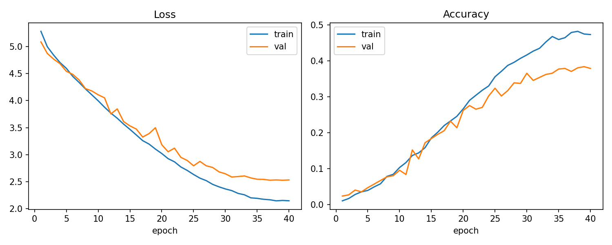
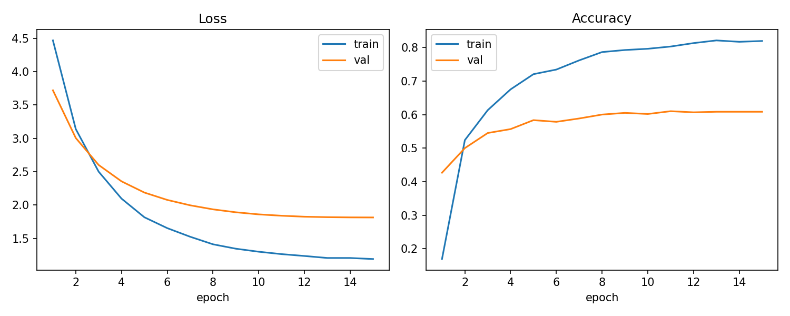
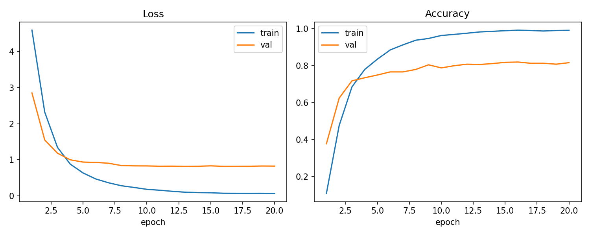
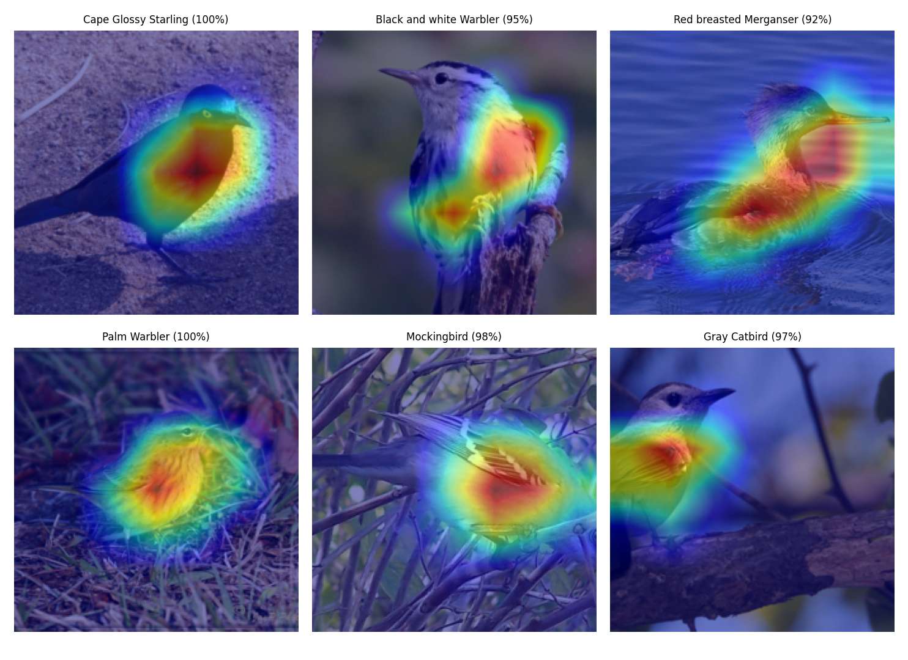
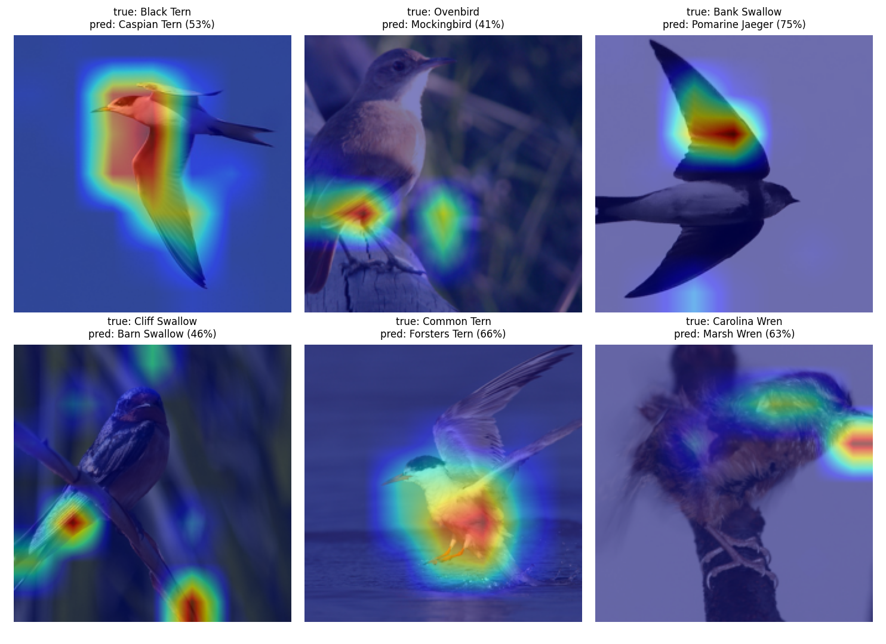
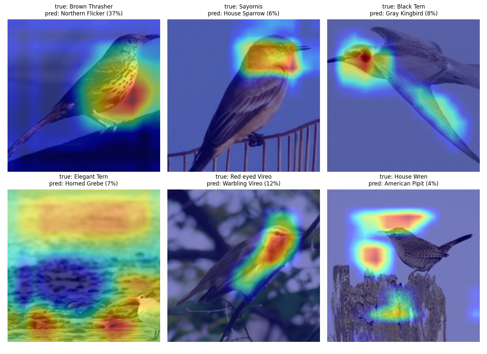
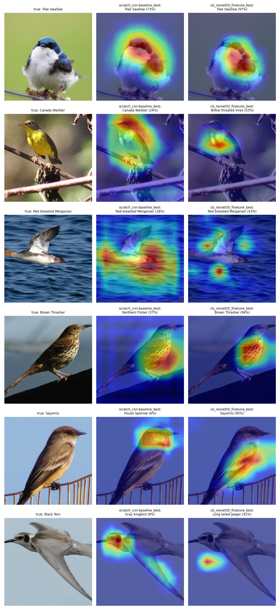

# Milestone 1 — Report notes

## Step 1 — Project setup and data pipeline (Jana)

**What I did**
- Made the folder structure from section 5.2 of the brief, `requirements.txt` and the README.
- Config files in YAML. `configs/base.yaml` has the shared settings, and other configs (like `cls_scratch.yaml`) start from it and only change what they need.
- `CUBDataset` loads the Hugging Face splits `Multimodal-Fatima/CUB_train` (5,994 images) and `CUB_test` (5,794 images). Every image is converted to RGB because a few CUB images are grayscale.
- A validation split: 10% of each class from the train set (seed 42), saved in `configs/splits/val_indices.json`.
- `build_dataloaders(cfg)` gives the train, val and test loaders.
- MLflow tracking in `src/utils/tracking.py`, and the CLI (`python -m src.cli eda/train/tune/predict`).

**Why**
- The dataset only has train and test. If we tuned on test, our test accuracy would look better than it really is, so we take val from train and use test only once at the end.
- Each class has only ~30 images. A normal random split could give some classes 0 or 1 val images, so we split per class to get exactly 3 per class.
- We saved the val indices in a file so everyone tunes on the same 600 images.
- All the MLflow code is in one file, so the training code doesn't depend on MLflow directly.

**Problems**
- `data/` in `.gitignore` also ignored `src/data/` by mistake. Changed it to `/data/`.

## Step 2 — EDA, cleaning, preprocessing and augmentation (Habiba)

All numbers come from `python -m src.cli eda --config configs/base.yaml`. It saves the figures, CSVs and `summary.json` to `outputs/figures/eda/`.

| What we found | What we did | Why |
|---------------|-------------|-----|
| **Classes:** train has 26–27 images per class (imbalance 1.04), val has exactly 3, test has 11–30 (imbalance 2.73; smallest: Least Auklet, Crested Auklet, Spotted Catbird). | No class weights. We report macro F1 next to accuracy. | Train is balanced, so class weights wouldn't change anything. Test is not balanced, and macro F1 counts every species equally. |
| **Image sizes:** almost all images have a longest side of 500 px (median 500×375). Aspect ratio goes from 0.38 to 3.6 (median 1.33). 148 images have a side smaller than 224 px. | Train: `RandomResizedCrop(224, scale=(0.5, 1.0))`. Val/test: `Resize(256)` + `CenterCrop(224)`. | Images are bigger than 224, so we don't lose much detail. We kept at least 50% of the image in the crop because the bird is often small. |
| **Color modes:** 11,780 RGB and 8 grayscale images (4 train, 4 test). No file is broken. | Keep them and convert to RGB. | Only 8 images, and they still show the right bird. |
| **Duplicates:** pHash (≤ 4 bits different) found 8 candidate pairs, but 3 were just different birds on a plain sky or snow background. We checked again with dHash (≤ 8): real duplicates differ by 0–1 bits, wrong matches by 15–17. In the end: 3 train–train pairs and 2 train–test pairs (Bronzed Cowbird, Prothonotary Warbler). | Removed 5 train images (`data.exclude_train_files`), so train went from 5,394 to 5,389. | The train–test duplicates mean the model would see test images while training, which makes test accuracy too high. Val and test are not changed. |
| **Color mean/std** of our train images: mean (0.486, 0.501, 0.433), std (0.232, 0.228, 0.267). ImageNet: mean (0.485, 0.456, 0.406), std (0.229, 0.224, 0.225). | Pretrained models use ImageNet values, and the scratch model uses `normalization: cub`. | Pretrained models expect the values they were trained with. Our images are greener and bluer than ImageNet (trees, sky, water). |
| **Captions:** every image has exactly 10 captions. Captions are 15.3 words on average (median 14, 95% under 24, longest 66). | For Milestone 2, captions can be cut at about 25–30 words. | That covers more than 95% of the captions. |
| **Caption noise:** about 100 captions have a broken character (`�`) instead of every space (`this��bird��has…`). Other odd characters: `/` 266 times, `;` 247, `&` 196, plus quotes and brackets. | `clean_caption` replaces `�` with a space, `&` with "and" and `/` with a space, lowercases everything, removes other symbols and fixes spaces around punctuation. | Without this, those captions would become one giant "word" each. |
| **Vocabulary:** 6,690 different words before cleaning and 4,076 after. Only 1,243 words appear 5 times or more; the other 2,833 are rare and are mostly typos (`abdomin`, `abdomon`, `aare`, `ablack`). | Rare words are saved in `rare_words.csv`. For Milestone 2 we'll keep words that appear at least 5 times and replace the rest with `<unk>`. | This removes almost all typos without fixing 2,800 words by hand. |

**Augmentation** (`src/data/transforms.py`): random crop, horizontal flip, rotation up to 10°, and small changes in brightness, contrast and saturation (0.2) and hue (0.02). No vertical flips, because birds are never upside down. We kept the hue change very small because color is what separates many species (for example Summer Tanager vs Scarlet Tanager). `augmentation_preview.png` shows 8 examples.

**Problems**
- pHash alone matched different birds on plain backgrounds. Lowering the threshold would have missed the Laysan Albatross duplicate (pHash distance 4, dHash 0), so we added dHash as a second check.
- The EDA takes about 3 minutes because it opens all 11,788 images.

## Step 3 — CNN from scratch, training and metrics (Nouran)

**What I did**
- `ScratchCNN` in `src/models/encoders.py`: 5 blocks of (Conv-BN-ReLU ×2, then MaxPool), channels 32 → 64 → 128 → 256 → 512, then global average pooling. `forward_features()` gives the 7×7×512 feature map, and `get_gradcam_layer()` gives the last conv layer for Grad-CAM in Step 5.
- `Classifier` in `src/models/classifier.py`: dropout + one linear layer. `build_model(cfg)` picks the encoder from the config, so changing to ResNet-50 later is a one-line config change.
- `train_model()` in `src/training/trainer.py`: AdamW, cosine learning-rate schedule, mixed precision (only on GPU), early stopping on val accuracy, saves the best model, and logs every epoch to MLflow. The same function will train the pretrained models and the tuning trials.
- `evaluate()` in `src/evaluation/metrics.py`: accuracy, top-5 accuracy, macro precision, recall and F1, and the confusion matrix.
- `plot_training_curves()` in `src/visualization/curves.py`: train vs val loss and accuracy.
- `python -m src.cli train --task classification --config configs/cls_scratch.yaml` runs everything: training, curves, test evaluation and MLflow logging.
- Total: 4.82M parameters (4.72M in the encoder, 103k in the classifier).

| Block | Channels | Output size (224px input) |
|---|---|---|
| 1 | 3 → 32 | 112×112 |
| 2 | 32 → 64 | 56×56 |
| 3 | 64 → 128 | 28×28 |
| 4 | 128 → 256 | 14×14 |
| 5 | 256 → 512 | 7×7 |
| Pooling + linear | 512 → 200 | 1×1 |

**Settings** (`configs/cls_scratch.yaml`): CUB normalization, dropout 0.3, AdamW with lr 3e-4 and weight decay 1e-4, cosine schedule, up to 40 epochs, early stopping after 10 epochs without improvement, mixed precision on.

**Why**
- *Global average pooling instead of flatten:* the last layer is 512 → 200 instead of 25,088 → 200, so there are far fewer parameters and less overfitting.
- *`forward_features` and `get_gradcam_layer` on the encoder:* Grad-CAM (Step 5) and colorization (Milestone 2) both need the feature map before pooling.
- *AdamW + cosine schedule:* it trains well without much learning-rate tuning.
- *Early stopping on val accuracy, not val loss:* accuracy is what we report, and with only ~27 images per class the val loss can keep going down while accuracy stops improving.
- *Mixed precision only on GPU:* the same code runs on a laptop CPU and on the T4.

**Baseline run**
- One epoch at 224px takes about 16 minutes on my CPU, so 30–50 epochs would take 8–13 hours. So we did the full run on a Kaggle T4 GPU.
- To check that everything works, I did a short run with 96px images and 3 epochs (temporary config, not committed): train loss went from 5.24 to 4.54, val accuracy from 2.2% to 4.5%, and test accuracy was 4.9% (macro F1 2.9%). The numbers are low because it was only 3 epochs on small images. This run was only to test the code.
- **Full run (40 epochs, 224px, Kaggle T4):**

| Metric | Result |
|---|---|
| Best val accuracy | 38.3% (epoch 39) |
| Test accuracy | 40.2% |
| Top-5 test accuracy | 72% |
| Macro F1 (test) | 38.8% |
| Final train accuracy | 47.3% |

- Random guessing would give 0.5%, so 40% is much better than chance, but it is still modest. We only have about 27 training images per species, the species look very alike, and the model starts with no pretrained knowledge.
- Early stopping didn't trigger, because val accuracy was still improving near the end. The model might gain a little more with more epochs, but the learning rate was almost 0 by then.
- Train accuracy (47.3%) is about 9 points above val (38.3%), so there is some overfitting, but not much. Dropout and augmentation helped here.
- Test accuracy came out a bit higher than val. Val has only 600 images, so its number moves around by a few points. We didn't use test for any decision.
- Macro F1 is close to accuracy, so the model isn't only doing well on the species with more test images.

**Problems**
- The first `train` run crashed when starting MLflow. On Windows, MLflow's default database path breaks when the user folder name has a space (`C:/Users/Nouran Mokhtar/...`). We fixed it by setting the path ourselves with `mlflow.set_tracking_uri("sqlite:///mlflow.db")` in `start_run()`.

## Step 4 — Transfer learning and hyperparameter tuning (Mohamed)

**What I did**
- `ResNet50Encoder` in `src/models/encoders.py`: ResNet-50 with ImageNet weights (`IMAGENET1K_V2`). I kept every layer up to `layer4` and removed its average pooling and 1000-class layer. It has the same methods as `ScratchCNN`, so the trainer, metrics and CLI didn't change. It gives a 2048×7×7 feature map and a 2048 vector.
- `model.freeze_backbone` in the config. When it is `true`, the encoder weights are locked and only the last layer learns. The encoder is also kept in eval mode, because BatchNorm keeps updating its running mean/std in train mode even when the weights are locked.
- Two configs: `cls_resnet50_frozen.yaml` (lr 1e-3, 15 epochs) and `cls_resnet50_finetune.yaml` (lr 1e-4, 20 epochs). Both use ImageNet normalization and early stopping after 5 epochs.
- `grid_search` and `random_search` in `src/training/tuning.py`, and the `tune` CLI command. Each trial is 5 epochs, starts from the same seed and is its own MLflow run. Grid tries lr {1e-4, 3e-4} × weight decay {1e-4, 1e-3}. Random tries 4 log-uniform values between the same limits.
- Runs are now named after their config file, so two ResNet-50 runs don't overwrite each other's checkpoint.
- One new test: freezing locks the encoder and keeps the last layer trainable.

**Why**
- *Pretrained model:* we only have ~27 images per species. ResNet-50 already learned edges, textures and shapes from 1.2M ImageNet images.
- *Frozen vs fine-tuned:* frozen only trains the last layer (fast, keeps ImageNet features as they are). Fine-tuned lets every layer adapt to birds, with a small lr so the ImageNet knowledge isn't destroyed.
- *ImageNet normalization:* ResNet-50 was trained with these values.
- *Random search between the grid values:* if it picked from the same 4 points it would just be the grid in another order.

**Results (Kaggle T4)**

| Model | Trainable params | Epochs | Train acc | Best val acc | Test acc | Macro F1 | Time |
|---|---|---|---|---|---|---|---|
| Scratch CNN (Step 3) | 4.82M | 40 | 47.3% | 38.3% | 40.2% | 38.8% | — |
| ResNet-50 frozen | 0.41M (of 23.9M) | 15 | 81.9% | 61.0% (epoch 11) | 64.3% | 64.0% | 9.6 min |
| **ResNet-50 fine-tuned** | 23.9M | 20 | 99.1% | **82.0%** (epoch 16) | **82.9%** | **82.9%** | 13.3 min |
| ResNet-50 tuned (lr 1.35e-4, wd 1.67e-4) | 23.9M | 16 (early stop) | 99.4% | 81.3% (epoch 11) | 81.8% | 81.8% | 10.7 min |

- Frozen is 24 points above scratch while training only the last layer. Val stopped improving after epoch 11, so one linear layer on fixed features reaches its limit.
- Fine-tuned is 18.6 points above frozen and more than double the scratch CNN. Train accuracy reaches 99% while val stays around 82%, so it memorizes the training images, but val loss doesn't rise, so val accuracy isn't hurt.

**Hyperparameter tuning: it did not improve the accuracy**

| Search | Best lr | Best weight decay | Best val acc (5 epochs) | Trials | Time |
|---|---|---|---|---|---|
| Grid | 3e-4 | 1e-4 | 79.5% | 4 | 12.5 min |
| Random | 1.35e-4 | 1.67e-4 | 79.7% | 4 | 12.6 min |

We trained the best setting (random search, 79.7%) for the full 20 epochs. It got 81.3% val and 81.8% test, a bit **below** the untuned fine-tuned model (82.0% val, 82.9% test). Why:
- **The trials were only 5 epochs.** The best setting over 5 epochs isn't always the best over 20, and their scores are lower than a full run (79.5% vs 82.0%) because the model hasn't finished learning.
- **The differences were noise.** All 6 trials with lr between 1.35e-4 and 3e-4 landed between 78.2% and 79.7%. On 600 val images, 1 point is about 6 images, so the "winner" wasn't really better.
- **The default was already good.** Every lr in the range gives about 80%, so lr 1e-4 was already a good choice.

**Final model:** we choose by **val**, not test. The untuned fine-tuned ResNet-50 (`configs/cls_resnet50_finetune.yaml`) has the best val accuracy (82.0%), so it is our final model: **82.9% test accuracy, 82.9% macro F1**. Checkpoint: `cls_resnet50_finetune_best.pt` on the team Drive.

**Problems**
- Both ResNet-50 runs were named `resnet50-baseline`, so the second run would have overwritten the first one's checkpoint and curves. Runs are now named after their config file.

## Step 5 — Grad-CAM, inference, error analysis and benchmarking (Abdallah)

**What I did**
- Our own Grad-CAM in `src/visualization/gradcam.py`, with no extra library. A forward hook on `model.get_gradcam_layer()` saves the feature maps, and a hook on that output tensor saves their gradients during backward. Each channel's gradient is averaged into one weight; we take the weighted sum of the maps, apply ReLU, resize to 224×224 and scale to 0..1. This is the last conv layer (512×7×7) for the scratch CNN and `layer4` (2048×7×7) for ResNet-50.
- `load_checkpoint()` in `src/models/classifier.py` rebuilds a model from its checkpoint, because the checkpoint holds its own config. `ResNet50Encoder(pretrained=False)` skips the ImageNet download in that case, since our weights replace it anyway.
- `predict` command: prints the top-5 species for one image and, with `--gradcam`, saves the heatmap. It reads the species names from `configs/class_names.json`, so it doesn't need the 1.2 GB dataset.
- `analyze` command: evaluates a checkpoint on the test set and finds the 5 most confused species pairs (`most_confused_pairs()` in `metrics.py`). It saves Grad-CAM grids of 6 correct and 6 wrong predictions (random, seed 42), and with `--compare` shows a second model on the same images. Everything is logged to MLflow as `analyze_<model>`.
- `docs/benchmark.md` compares us with published ResNet-50 results, and `docs/references.md` lists every source.
- 3 new tests: Grad-CAM shape and range (also with a frozen encoder), `load_checkpoint`, and `most_confused_pairs`.

**Why**
- *Grad-CAM on the last conv layer:* it is the last layer that still knows *where* things are (7×7), and its channels are the most "species-like" features. Earlier layers detect edges and textures.
- *ReLU:* we only want the regions that make the class score go up, not the ones that argue against it.
- *`requires_grad` on the input image:* in the frozen ResNet-50 no encoder weight needs a gradient, so PyTorch wouldn't record the graph through `layer4` and the gradient hook would never run. Making the input need a gradient fixes it without changing the result.
- *Each model gets its own preprocessing:* the scratch CNN was trained with CUB mean/std and ResNet-50 with ImageNet mean/std, so `predict` and `analyze` take the normalization from the checkpoint's config.
- *Confused pairs counted in both directions:* "A predicted as B" and "B predicted as A" are the same problem: the model can't tell A and B apart.

**Check:** `analyze` reproduces the test numbers from Steps 3 and 4 exactly: scratch 40.2% accuracy / 38.8% macro F1, ResNet-50 82.9% / 82.9%.

**Most confused species pairs (test set, mistakes in both directions)**

| # | Scratch CNN | ResNet-50 fine-tuned |
|---|---|---|
| 1 | Eared Grebe ↔ Horned Grebe: 13 | Long-tailed Jaeger ↔ Pomarine Jaeger: 15 |
| 2 | Arctic Tern ↔ Common Tern: 13 | Chuck-will's-widow ↔ Whip-poor-will: 14 (all 14 one way) |
| 3 | Loggerhead Shrike ↔ Great Grey Shrike: 12 | Brandt's Cormorant ↔ Pelagic Cormorant: 14 |
| 4 | Arctic Tern ↔ Forster's Tern: 12 | Acadian Flycatcher ↔ Yellow-bellied Flycatcher: 12 |
| 5 | Blue-winged Warbler ↔ Prothonotary Warbler: 12 | Arctic Tern ↔ Common Tern: 12 |

- Every ResNet-50 pair is two species of the **same family** that look almost the same, and even birders separate them by small details or by their song. These are "honest" mistakes.
- The scratch CNN also mixes up birds that only share a color: Blue-winged and Prothonotary Warblers are both yellow but otherwise look different. It relies on color more than on shape.
- Chuck-will's-widow → Whip-poor-will goes only one way (14 + 0): ResNet-50 calls both of them Whip-poor-will.

**Grad-CAM findings**

- **ResNet-50, correct (92–100% confidence):** the heat is on the bird's body, breast and wing pattern, for example the stripes of the Black-and-white Warbler or the streaks of the Palm Warbler. The background stays cold.
- **ResNet-50, wrong (41–75% confidence):** the confidence is clearly lower, so the model "knows" it is unsure. Most mistakes are lookalikes (Common Tern → Forster's Tern, Cliff Swallow → Barn Swallow, Carolina Wren → Marsh Wren on a blurry photo). In a few the attention is off the bird: on the Ovenbird it looks at the legs and perch, and on the Cliff Swallow at the reeds. One mistake is about shape: a Bank Swallow photographed from below in flight is called a Pomarine Jaeger (75%), with the heat on the wing silhouette, the only thing visible against the sky.
- **Scratch CNN, wrong (4–37% confidence):** it often looks at the **background**. On the Elegant Tern the heat covers the water and the small bird in the corner gets almost none (prediction: Horned Grebe, also a water bird). On the House Wren the heat is on the sky above the bird. It learned shortcuts like "water means a water bird", which is expected with ~27 images per class and no pretraining. Some of its mistakes still make sense: Brown Thrasher → Northern Flicker, both with a spotted breast.
- **Side by side:** on the Brown Thrasher and the Sayornis the scratch CNN is wrong, while ResNet-50 is right at about 95% and focuses on the spotted breast and the body. There are also counterexamples. The scratch CNN gets a Canada Warbler right (24%) that ResNet-50 calls a Yellow-throated Vireo (53%). On the Red-breasted Merganser ResNet-50 is right but its heat is scattered over the water. Grad-CAM shows where the evidence is, not a guarantee that the model is right for the right reason.

**Benchmark** (details in `docs/benchmark.md`): at the same 224 px input, our fine-tuned ResNet-50 (82.9%) matches the published ResNet-50 result of 81.5% (Li et al., DT-RAM). Papers at 448 px report 84.5–85.3%, and DT-RAM measured that going from 224 to 448 alone adds 3 points. We also use stronger ImageNet weights (`IMAGENET1K_V2`), train on 10% fewer images (val held out) and for 20 epochs instead of 90.

**Problems**
- Building ResNet-50 to load our checkpoint downloaded the ImageNet weights first (~100 MB) and then threw them away, and `predict` failed without internet. Fixed with `pretrained=False` when loading a checkpoint.
- The species list in the dataset is **not in alphabetical order** (label 199 is Common Yellowthroat), so `class_names.json` is saved in label order and must never be sorted.
- Grad-CAM maps are only 7×7 before resizing, so they show regions, not fine details like an eye ring.
